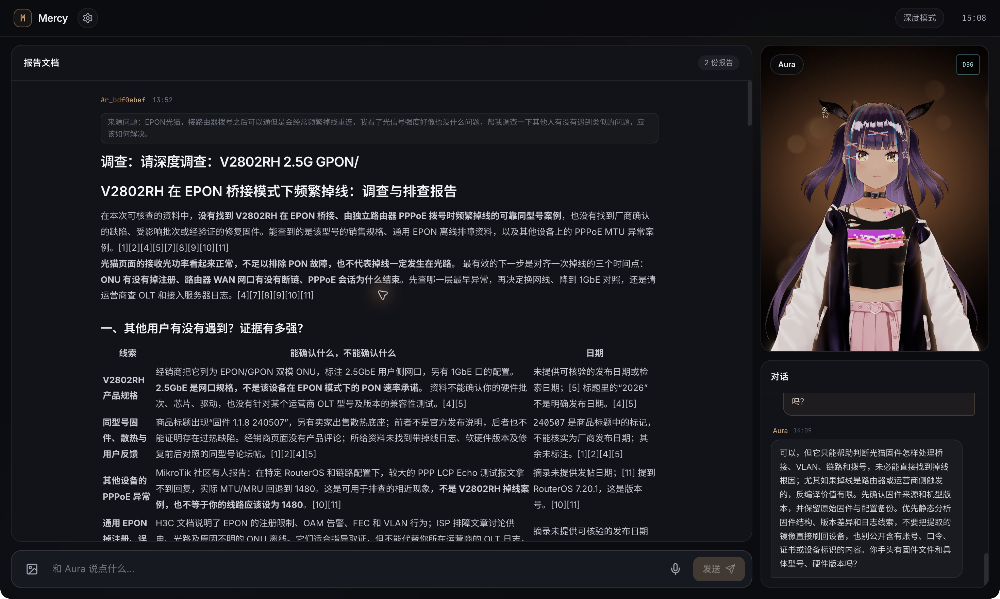
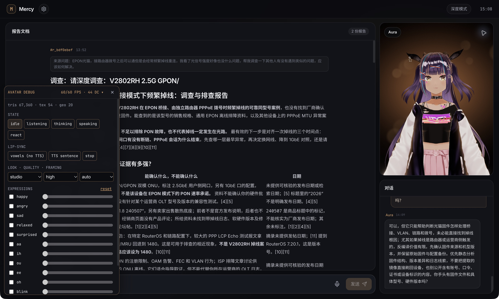

# Mercy Protocol

> A local-first, multimodal personal AI assistant with a report workspace, an interactive VRM avatar, a LangGraph agent engine, and real-time backend telemetry.



Captured from the local web app on **2026-11-24** (commit `927b5ee`). Reports
occupy the main workspace, with Aura and the spoken conversation on the right.
The top-left settings button opens model configuration, API keys, usage
statistics, and backend logs; the top-right control selects deep research mode.

## Features

- **LangGraph agent** — multi-turn reasoning, autonomous tool calls, exponential-backoff retries
- **Hybrid memory** — async SQLite checkpointer (short-term) + ChromaDB vector store with OpenAI `text-embedding-3-small` (long-term RAG)
- **Multimodal vision** — attached images go natively to the agent model as `image_url` content blocks
- **Streaming replies** — `/api/chat` streams speech sentences, report updates, tool events, and status over SSE; chat and vision use configured OpenAI or DeepSeek models, while video/PDF analysis uses Gemini (no local model inference)
- **VRM avatar** — three.js rendering, idle motion, eye tracking, viseme lip-sync timed from TTS word boundaries
- **Voice I/O** — browser speech recognition + sentence-based `edge-tts` audio and timed avatar lip-sync
- **Live telemetry** — every backend step streamed to the UI over SSE (`/api/logs`)
- **Model settings** — configure provider keys and full/convenient profiles in the settings drawer, with usage statistics and live backend logs
- **Desktop or web** — run in a browser via Vite, or as a transparent always-on-top Tauri v2 window

The screenshots and instructions here describe the current interface.
[docs/feature-overview.md](docs/feature-overview.md) is a historical design and
feature overview: its three-column HUD, screenshots, and some API/model
examples predate the current report workspace and configuration system.

## Project Structure

```
.
├── backend/                 # FastAPI + LangGraph service (:8000)
│   ├── main.py              # API: /api/chat, /api/logs (SSE), /api/speech
│   ├── core/
│   │   ├── agent/graph.py   # LangGraph state graph, tools, LLM setup
│   │   ├── memory/          # ChromaDB long-term memory
│   │   └── log_bus.py       # Real-time log pub/sub
│   ├── requirements.txt
│   └── .env.example
├── frontend/                # React 19 + Vite + Tailwind v4 + Tauri v2 (:1420)
│   ├── src/                 # App.tsx (workspace), ModelSettings.tsx, VRMAvatar.tsx
│   ├── src-tauri/           # Rust desktop shell
│   └── public/vrm/          # avatar.vrm (pixiv sample, redistributable)
└── docs/
    ├── feature-overview.md
    ├── plans/               # Design & implementation plans
    └── screenshots/
```

## Getting Started

### Prerequisites

- Python 3.12 recommended (backend CI also tests Python 3.10)
- Node.js 20.19+ on the 20.x release line, or 22.12+ (Vite 7 requirement)
- Rust toolchain (only for the Tauri desktop build)

### 1. Backend

```bash
cd backend
python3.12 -m venv venv
./venv/bin/pip install -r requirements.txt
cp .env.example .env        # first setup only; preserve an existing .env
# Replace placeholder keys and select models available to your provider account.
./venv/bin/python -m uvicorn main:app --host 127.0.0.1 --port 8000 --timeout-graceful-shutdown 3
```

The command above starts the backend without automatic reload. For development,
run the built-in entry point from `backend/` instead:

```bash
./venv/bin/python main.py
```

`main.py` enables reload, listens on port **8000**, and reads `BACKEND_HOST`
from `.env` (default `127.0.0.1`). For the direct uvicorn command, pass `--host`
explicitly to change the bind address. Both examples bound the graceful wait
for open streams, such as `/api/logs`, to **3 seconds**. Application cleanup and
worker startup can add time beyond that wait. Reload/Ctrl+C may log
`timeout graceful shutdown exceeded` and a `CancelledError` traceback; if
cleanup completes and the process exits or the new worker starts, those
messages alone do not indicate failure.

If file edits are not detected on macOS/Linux, try polling in that process:

```bash
WATCHFILES_FORCE_POLLING=true ./venv/bin/python main.py
```

Polling was needed during local macOS verification; it is a workaround for
file-change detection, not a required setting on every machine. Keep the page
open during reload: its log SSE connection should reconnect automatically.
If Vite serves stale frontend code, restart `npm run dev` and refresh the page.

Runtime data (`aura_checkpoints.db`, `data/chroma_db/`) is created inside `backend/`.
When `backend/data/profiles.json` exists, it takes precedence over the `.env`
`MODEL_*` settings; set `MERCY_PROFILES_PATH` to use a different profile file.
In profile mode, `.env` model selections are ignored, while API keys remain
environment-based.

On Windows, do not pipe or redirect `python main.py` (or any `--reload` start)
in PowerShell, e.g. `| Tee-Object` or `> log.txt`: on each reload uvicorn sends
Ctrl+C to the whole console, PowerShell treats it as the user's and stops the
backend. To keep a log file, start it through `cmd` and follow the log from
PowerShell:

```powershell
cmd /c "venv\Scripts\python main.py > log.txt 2>&1"
Get-Content log.txt -Wait   # in a second window
```

With `$ErrorActionPreference = 'Stop'`, `2>&1` also aborts at startup, because
PowerShell turns the first uvicorn log line on stderr into a terminating error.

System environment API keys override `.env` keys and cannot be changed in the
configuration UI (the API returns HTTP 409); update those keys in the operating
system environment instead. The `.env` file must be UTF-8 encoded.

Saving model profiles through **测试并保存** creates
`backend/data/profiles.json` on the first successful profile save. This is
separate from saving an API key: **key saves write `backend/.env` and do not
create the profile file**. Once profiles exist, `MODEL_*` environment selections
no longer apply; review any settings listed as `seed_dropped` before saving,
because they cannot be represented by profiles.

Key saves validate against the configured provider: OpenAI, DeepSeek, and Gemini
use model discovery; Tavily uses `/usage`. A placeholder or invalid key normally
fails validation. After a successful save, the provider row shows the green
**已保存，key 有效** notice for about **4 seconds**. This confirms that the save-time
validation succeeded; it does not guarantee access to every model or operation.
For offline UI testing, use a local provider stub rather than treating a fake
key as a valid production credential.

#### Providers and API compatibility

| Capability | Provider / configuration |
| :--- | :--- |
| Conversation, reports, research, and image analysis | OpenAI (`OPENAI_API_KEY`) or DeepSeek (`DEEPSEEK_API_KEY`); configure each role with `provider:model[@effort]` or in the settings drawer. Image support depends on the selected model. |
| Long-term memory embeddings | OpenAI-compatible embeddings endpoint, `OPENAI_API_KEY`, and `OPENAI_EMBEDDING_MODEL` (default `text-embedding-3-small`). |
| Video and PDF analysis | Gemini, using `GEMINI_API_KEY` (or `GOOGLE_API_KEY`) and the configured video role. |
| Web search | Tavily, using `TAVILY_API_KEY`. |

`OPENAI_BASE_URL` applies to the OpenAI provider and memory embeddings; it does
not redirect the dedicated DeepSeek or Gemini providers. Compatibility depends
on the operations used, rather than the endpoint's name: the backend uses Chat
Completions or Responses API behavior according to the provider/model effort
configuration, streaming and tool calls for the agent, `/models` for key/model
discovery, and embeddings when long-term memory is enabled. Check those
capabilities for your chosen gateway and models; support for a simple text
completion alone is insufficient.

#### Video/PDF limits and retention

Video and PDF analysis is optional. Configure an available Gemini model for the
video role; `.env.example` supplies a model example, not an access guarantee.
Mercy accepts uploaded PDFs up to **50 MiB** and videos up to **200 MiB**. Its
PDF analysis reads at most `PDF_MAX_PAGES=300` pages per call by default; use
`start_page` to continue through a longer document. The model's reported total
page count is only trustworthy when pages were actually read; an out-of-range
page window returns no content, and the app refuses to answer in that case.

Mercy deletes analyzed Gemini files after **15 minutes without another question**
by default (`GEMINI_FILE_RETENTION_SECONDS=900`; set `0` to delete immediately).
Files left by an abnormal exit are cleaned on the next startup. These are app
policies; provider-side limits and retention are separate. Quota exhaustion is
reported to the user without retry, and the app does not choose behavior based
on the account's free/paid tier.

For current provider details, consult Google's official
[Files API documentation](https://aistudio.google.com/docs/files),
[document processing documentation](https://aistudio.google.com/docs/document-processing),
[pricing](https://aistudio.google.com/docs/pricing), and
[data-use terms](https://aistudio.google.com/docs/terms).
External links checked **2026-11-24**. Model availability, quotas, token accounting,
pricing, and data-use terms can change; this README does not freeze those values.

### 2. Avatar model

The frontend loads `frontend/public/vrm/avatar.vrm`, pixiv's VRM 1.0 sample model, which is licensed for redistribution, modification and commercial use (see `frontend/public/vrm/LICENSE.md`). To use your own character, export a VRM 1.0 file (e.g. from [VRoid Studio](https://vroid.com/en/studio)) and replace that file.

Lip-sync: `POST /api/speech` returns the edge-tts audio plus a viseme track (`aa/ih/ou/ee/oh` with start/end times), built from edge-tts word boundaries and pypinyin finals.

#### Avatar debugging

In the Vite development server, **DBG** appears at the top-right of the avatar
card, aligned with the **Aura** name at the top-left. It also appears in a
production build when the URL includes `?debug`.

Click **DBG** to open the floating **AVATAR DEBUG** panel at the bottom-left
of the page. Use it to inspect FPS and rendering statistics, exercise avatar
states and lip-sync, and adjust lighting, quality, framing, or expressions.
The panel scrolls when needed; click its heading to collapse it, or **×** to
close it and restore the DBG button. The silent vowel test needs no LLM call;
**TTS sentence** calls the backend speech endpoint.



Captured on **2026-11-24**, using the same running app as the main screenshot.

### 3. Frontend

```bash
cd frontend
npm ci                      # install the locked dependency versions
npm run dev                 # web: http://localhost:1420
npm run tauri dev           # or: native desktop window
```

## Local validation

From the repository root, with the backend virtual environment already created:

```bash
cd backend
./venv/bin/pip install -r requirements-dev.txt
./venv/bin/python -m ruff check --select F821,F811,F822,F823 .
./venv/bin/python -m pytest -q
```

In a second terminal, from the repository root:

```bash
cd frontend
npm ci
npm run build
npm run check:media
```

On Windows, use `venv\Scripts\python` in place of `./venv/bin/python`.
CI runs backend checks on Ubuntu with Python 3.10 and 3.12, on Windows with
Python 3.12, and runs the frontend build/media checks with Node.js 20.

For a manual smoke test, start both services and open `http://localhost:1420`.
Open **设置与状态 → 后端日志**, keep the page open while triggering a backend
reload, and confirm the log stream reconnects. Check that Ctrl+C releases port
8000. With a valid provider key (or a local stub for UI-only testing), verify
the green save notice clears after about four seconds. In the development
server, check that DBG opens, folds, closes, and reopens the avatar debug panel.

## Tech Stack

| Layer | Stack |
| :--- | :--- |
| Frontend | React 19, TypeScript, Vite, Tailwind CSS v4, Framer Motion, three.js + @pixiv/three-vrm |
| Desktop | Tauri v2 (Rust) |
| Backend | FastAPI, LangGraph, LangChain OpenAI, edge-tts, pypinyin, langchain-tavily |
| Storage | SQLite (LangGraph checkpointer), ChromaDB |
