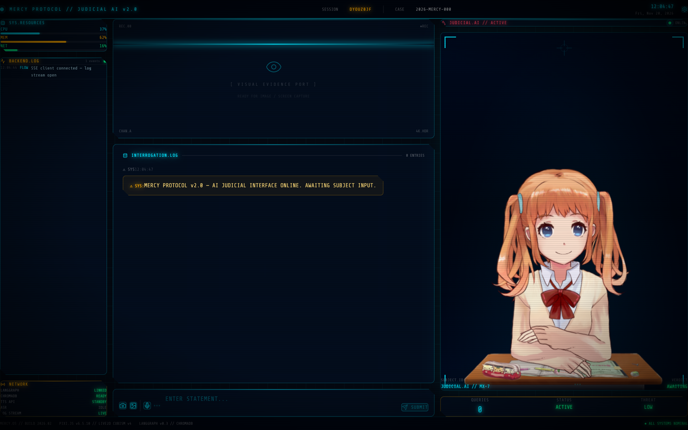

# Mercy Protocol

> A local-first, multimodal personal AI assistant with a holographic HUD, an interactive VRM avatar, a LangGraph agent engine, and real-time backend telemetry.



## Features

- **LangGraph agent** — multi-turn reasoning, autonomous tool calls, exponential-backoff retries
- **Hybrid memory** — async SQLite checkpointer (short-term) + ChromaDB vector store with OpenAI `text-embedding-3-small` (long-term RAG)
- **Multimodal vision** — attached images go natively to the agent model as `image_url` content blocks
- **Streaming replies** — `/api/chat` streams tokens over SSE; LLM, vision and embeddings all use the OpenAI API (no local inference)
- **VRM avatar** — three.js rendering, idle motion, eye tracking, viseme lip-sync timed from TTS word boundaries
- **Voice I/O** — browser speech recognition + `edge-tts` streaming TTS
- **Live telemetry** — every backend step streamed to the UI over SSE (`/api/logs`)
- **Desktop or web** — run in a browser via Vite, or as a transparent always-on-top Tauri v2 window

See [docs/feature-overview.md](docs/feature-overview.md) for the full walkthrough, architecture diagram, and assessment.

## Project Structure

```
.
├── backend/                 # FastAPI + LangGraph service (:8000)
│   ├── main.py              # API: /api/chat, /api/logs (SSE), /api/tts
│   ├── core/
│   │   ├── agent/graph.py   # LangGraph state graph, tools, LLM setup
│   │   ├── memory/          # ChromaDB long-term memory
│   │   └── log_bus.py       # Real-time log pub/sub
│   ├── requirements.txt
│   └── .env.example
├── frontend/                # React 19 + Vite + Tailwind v4 + Tauri v2 (:1420)
│   ├── src/                 # App.tsx (HUD), VRMAvatar.tsx
│   ├── src-tauri/           # Rust desktop shell
│   └── public/vrm/          # avatar.vrm (pixiv sample, redistributable)
└── docs/
    ├── feature-overview.md
    ├── plans/               # Design & implementation plans
    └── screenshots/
```

## Getting Started

### Prerequisites

- Python 3.12
- Node.js 20+
- Rust toolchain (only for the Tauri desktop build)

### 1. Backend

```bash
cd backend
python3.12 -m venv venv
./venv/bin/pip install -r requirements.txt
cp .env.example .env        # then fill in your API keys / model names
set -a; [ ! -f .env ] || . ./.env; set +a
./venv/bin/python -m uvicorn main:app --host "${BACKEND_HOST:-127.0.0.1}" --port 8000
```

Any OpenAI-compatible endpoint works (OpenAI, Volcengine Ark, etc.) via `OPENAI_BASE_URL`.
The backend binds to `127.0.0.1` by default; set `BACKEND_HOST` in `.env` to override it.
Runtime data (`aura_checkpoints.db`, `data/chroma_db/`) is created inside `backend/`.
Legacy memories in the `personal_assistant_memory` collection are not automatically carried over to `personal_assistant_memory_openai`, which uses OpenAI embeddings.
When `backend/data/profiles.json` exists, it takes precedence over the `.env`
`MODEL_*` settings; set `MERCY_PROFILES_PATH` to use a different profile file.
In profile mode, `.env` model selections are ignored, while API keys remain
environment-based.

Gemini video and PDF analysis is optional (`GEMINI_API_KEY` or `GOOGLE_API_KEY`
plus `MODEL_VIDEO=gemini:gemini-3.8-flash`). PDFs are upload-only, limited to
50 MB and Google's 1,000-page limit. Each call reads a window of up to
`PDF_MAX_PAGES=300` pages (about 520 image tokens per page, or 156,000 tokens
for a full window); use `start_page` to continue through a longer document.
The model's reported total page count is only trustworthy when pages were
actually read; an out-of-range page window returns no content, and the app
refuses to answer in that case.
On the Gemini free tier, Google may use uploaded videos and files to improve
its products, and people may review them; the paid tier does not use this
content for product improvement or human review. Mercy does not change behavior
based on tier: quota exhaustion is reported to the user and is never retried.
Gemini's Files API free-tier limit is 2 GB per file, and Google automatically
deletes files after 48 hours. Mercy deletes analyzed videos and documents after
15 minutes without another question by default (`GEMINI_FILE_RETENTION_SECONDS`,
set it to `0` to delete immediately); files left by an abnormal exit are cleaned
on the next startup. The paid-tier Gemini 3.8 Flash input price reference is
$0.75 per 1 million tokens through 2026-12-31 and $1.50 per 1 million tokens
starting 2027-01-01.

### 2. Avatar model

The frontend loads `frontend/public/vrm/avatar.vrm`, pixiv's VRM 1.0 sample model, which is licensed for redistribution, modification and commercial use (see `frontend/public/vrm/LICENSE.md`). To use your own character, export a VRM 1.0 file (e.g. from [VRoid Studio](https://vroid.com/en/studio)) and replace that file.

Lip-sync: `POST /api/speech` returns the edge-tts audio plus a viseme track (`aa/ih/ou/ee/oh` with start/end times), built from edge-tts word boundaries and pypinyin finals.

### 3. Frontend

```bash
cd frontend
npm install
npm run dev                 # web: http://localhost:1420
npm run tauri dev           # or: native desktop window
```

## Tech Stack

| Layer | Stack |
| :--- | :--- |
| Frontend | React 19, TypeScript, Vite, Tailwind CSS v4, Framer Motion, three.js + @pixiv/three-vrm |
| Desktop | Tauri v2 (Rust) |
| Backend | FastAPI, LangGraph, LangChain OpenAI, edge-tts, pypinyin, langchain-tavily |
| Storage | SQLite (LangGraph checkpointer), ChromaDB |
