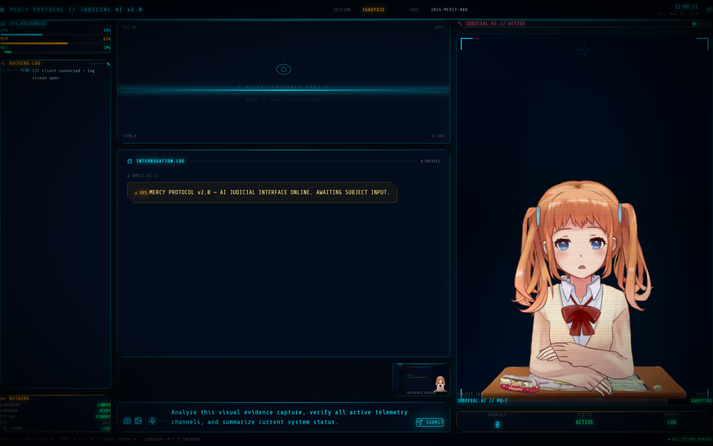
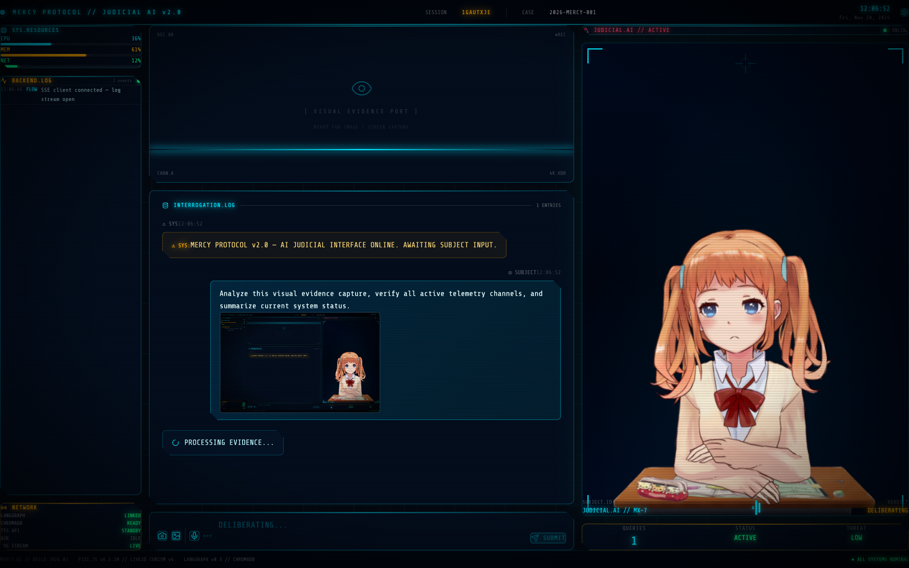
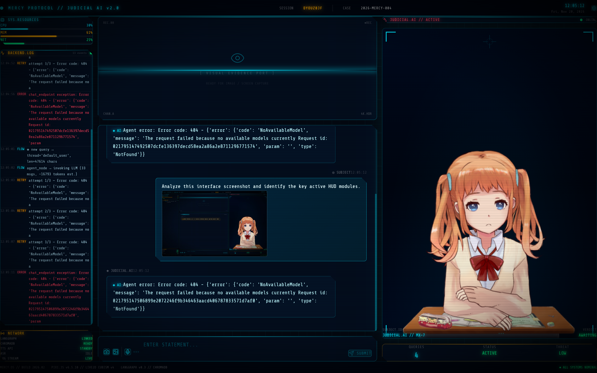
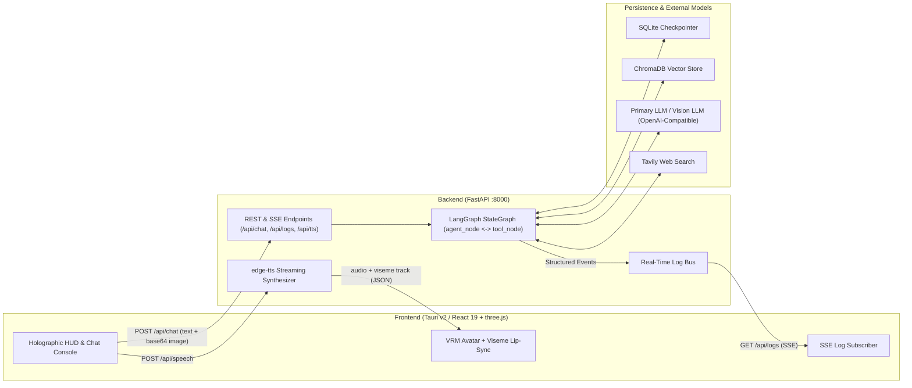

# Mercy Protocol v2.0 (Aura OS) — Feature Specification & Visual Walkthrough

**Mercy Protocol v2.0 (Aura OS)** is a local-first, multimodal personal AI assistant featuring a futuristic holographic HUD (Head-Up Display), an interactive **VRM** digital avatar with viseme lip synchronization, a **LangGraph** stateful agent orchestration engine, hybrid short-term/long-term memory (**SQLite + ChromaDB**), and real-time backend observability via **Server-Sent Events (SSE)**.

---

## 1. Visual Walkthrough (Live Screenshots)

### 1.1 Main Holographic Command Console (Idle State)
The primary workspace uses a three-column tactical layout designed for desktop fullscreen deployment (Tauri v2 / Web):
- **Top Command Bar**: Displays system identity (`MERCY PROTOCOL // JUDICIAL AI v2.0`), randomized `SESSION` ID, incremental `CASE` tracker, real-time clock, and window drag region.
- **Left Telemetry Sidebar**: Live hardware resource bars (`SYS.RESOURCES`), real-time SSE event console (`BACKEND.LOG`), and subsystem readiness matrix (`NETWORK`).
- **Center Evidence & Interrogation Workspace**: `[ VISUAL EVIDENCE PORT ]` scanner frame, scrollable `INTERROGATION.LOG` transcript, and multimodal input console (camera trigger, image upload, voice ASR mic + waveform, text input).
- **Right Neural Avatar Terminal**: WebGL-rendered **VRM** character (pixiv sample model) framed with holographic corner brackets, targeting reticle, live status indicators (`VERDICT: AWAITING`), and session KPI counters.

---

### 1.2 Multimodal Evidence Staging & Interactive Avatar
Users can attach local visual evidence before submitting a prompt. The UI stages the selected image in a dismissible `EVIDENCE.QUEUED` preview card above the input console while enabling multimodal annotation. Clicking the avatar makes it smile and nod. (Screenshot below predates the switch from Live2D to VRM.)

---

### 1.3 Active Deliberation & Visual Evidence Submission
Upon submission, the uploaded image is rendered inline inside the `INTERROGATION.LOG` thread alongside the subject's prompt. While the LangGraph pipeline executes, the console transitions into active processing mode (`PROCESSING EVIDENCE...`, input locked to `DELIBERATING...`, verdict status switches to amber `DELIBERATING`, and the audio/activity waveform activates beneath the avatar).

---

### 1.4 Real-Time Backend Observability & Resilience Telemetry (`BACKEND.LOG`)
Every backend step is broadcast over `/api/logs` (SSE) to the left sidebar with color-coded categories (`FLOW` cyan, `LLM` green, `TOOL` amber, `RETRY` orange, `ERROR` red). The capture below demonstrates real-time thread tracking, token estimation, and built-in **exponential backoff retry logic** (attempts 1/3 → 2/3 → 3/3) when an upstream LLM endpoint returns a transient or `NoAvailableModel` error.

---

## 2. Core Functional Capabilities

| Capability Domain | Key Features | Technical Stack / Implementation |
| :--- | :--- | :--- |
| **Conversational Agent Engine** | Multi-turn reasoning, autonomous tool selection, retry with exponential backoff (`1s / 2s / 4s`) for `429`, `503`, and `NoAvailableModel` faults. | **LangGraph** (`StateGraph`) + **LangChain OpenAI-compatible SDK** |
| **Hybrid Memory Architecture** | **Short-Term Memory**: Thread-scoped conversational state persistence across restarts. **Long-Term Semantic Memory (RAG)**: Automatic vector retrieval of top-3 relevant user facts/preferences injected into every system prompt, plus explicit `save_memory` tool. | **SQLite** (`AsyncSqliteSaver` in `aura_checkpoints.db`) + **ChromaDB** (`PersistentClient`, OpenAI `text-embedding-3-small` embeddings, near-duplicate skip on write) |
| **Native Multimodal Vision** | Users upload local images (base64 data URI); the image is sent to the agent as an `image_url` content block in the `HumanMessage`. Turns with an image run on `OPENAI_VISION_MODEL`, others on `DEFAULT_MODEL`. | React `FileReader` + FastAPI `/api/chat` (SSE) |
| **Interactive VRM Avatar & Lip-Sync** | Renders a redistributable VRM 1.0 model with upper-body framing, breathing/sway idle motion, auto-blink, pointer eye-tracking, click reactions, and `aa/ih/ou/ee/oh` viseme lip-sync timed from edge-tts word boundaries mapped through pypinyin finals (`POST /api/speech`). | **three.js** + **@pixiv/three-vrm** + edge-tts `WordBoundary` + pypinyin |
| **Voice I/O (ASR & Streaming TTS)** | **Speech-to-Text (ASR)**: Browser Web Speech API dictation (`zh-CN`) with live waveform indicator. **Text-to-Speech (TTS)**: On-demand streaming MP3 synthesis (`zh-CN-XiaoxiaoNeural`) automatically synced with avatar lip movement. | Browser `SpeechRecognition` + **edge-tts** via FastAPI `/api/tts` |
| **Built-in Tool Ecosystem** | - `web_search`: Real-time web lookup (Tavily, max 3 results) - `save_memory`: Explicit long-term preference storage - `create_local_directory`: Sandboxed local folder creation in `AURA_WORKSPACE_DIR` - `get_current_time` & `check_weather`: Utility/demo tools | LangChain `@tool` decorators + LangGraph `ToolNode` + `langchain-tavily` `TavilySearch` |
| **Real-Time Observability** | Live structured log broadcasting from synchronous LangGraph nodes to all subscribed frontend clients without polling, capped at 300 in-memory entries on the UI. | Custom `log_bus` pub/sub queue + FastAPI **SSE** (`/api/logs`) + Browser `EventSource` |
| **Desktop & Web Dual Runtime** | Runs either in a standard browser (`Vite` dev server) or wrapped as a native transparent, borderless, always-on-top desktop overlay. | **Tauri v2** (Rust shell) + **React 19** + **TypeScript** + **Tailwind CSS v4** |

---

## 3. System Architecture & Data Flow

---

## 4. Architectural Assessment (Cost, Deployment & Testability)

| Dimension | Current Implementation Status | Key Considerations & Gaps |
| :--- | :--- | :--- |
| **Development Cost** | Low — leverages managed LLM/Vision endpoints, redistributable VRM sample model, and turnkey LangGraph + ChromaDB primitives. | Several HUD widgets (`SYS.RESOURCES` CPU/MEM/NET, `THREAT: LOW`, Camera button, Settings button, `[ VISUAL EVIDENCE PORT ]` live feed) are currently UI placeholders and require backend/hardware integration to become functional. |
| **Deployment Complexity** | Moderate — requires co-running Python 3.12 (`uvicorn`), Node/Vite (or compiled Tauri binary), and external internet access for Google Fonts, the OpenAI API (plus DeepSeek or Gemini when configured), Tavily, and `edge-tts`. | Model roles are set with `MODEL_*` (`provider:model[@reasoning_effort]`) or `backend/data/profiles.json`; OpenAI calls and memory embeddings (`OPENAI_EMBEDDING_MODEL`) use `OPENAI_BASE_URL` (defaults to the official OpenAI API). `backend/venv` shebangs are path-bound when relocating the repository (use `python -m uvicorn`). |
| **Testability** | Good for UI/SSE inspection; moderate for agent logic. | 1. `/api/chat` asynchronously iterates `process_query()` to stream LangGraph tokens and tool events over SSE; blocking memory operations run off the event loop. 2. External API dependencies require valid credentials and available models, so end-to-end automated testing benefits from an injectable mock LLM mode. |
